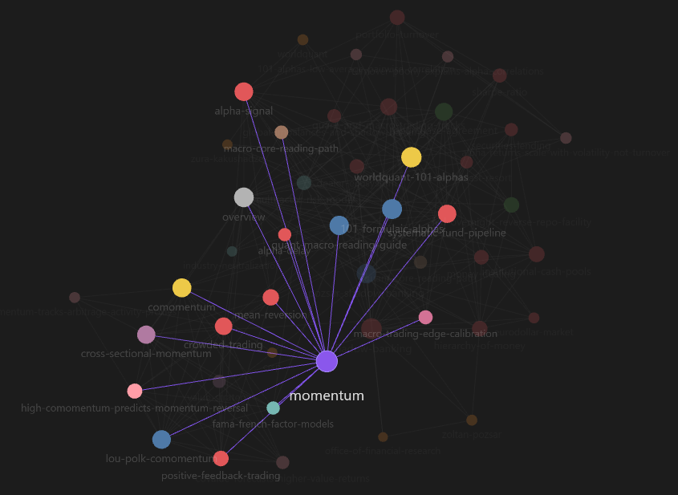

# llm-wiki skill for Claude Code

Builds and maintains an LLM-written knowledge graph from your own sources (PDFs, papers, books,
articles, notes) as an Obsidian vault. The vault uses the same layout as the
[LLM Wiki desktop app](https://github.com/nashsu/llm_wiki), so it opens in both.



## Install

In Claude Code:

```
/plugin install llm-wiki --marketplace StevenGuo42/llm-wiki-skills
```

On Claude Code older than 2.1.275, run `/plugin marketplace add StevenGuo42/llm-wiki-skills`, then
`/plugin install llm-wiki@llm-wiki-skills`. Or copy the skill by hand:
`cp -r skills/llm-wiki ~/.claude/skills/llm-wiki`.

Requirements: Node 18+, and poppler for PDFs (`brew install poppler`, `apt install poppler-utils`,
`winget install oschwartz10612.Poppler`). `pdftotext` extracts the text; `pdftoppm` lets Claude look at
pages whose equations or tables are images. Git for Windows bundles `pdftotext` only.

## Use

Ask Claude in plain language:

- "Create an LLM wiki about monetary economics in `~/vaults/money`"
- "Add these sources to my wiki: a.pdf, b.pdf, the folder ./papers"
- "Remove *Book Title* from the wiki"
- "Make my wiki's graph show up in Obsidian" / "lint my wiki"

Then open the vault in Obsidian and press Ctrl/Cmd+G for the graph.

## What it does

- Sets up a vault from one of the LLM Wiki app's templates (general, research, reading, personal
  growth, business) or from a purpose and page types you design, and won't ingest until `purpose.md`
  is filled in.
- Ingests many sources, up to 4 at once (one agent per source); long sources go section by
  section and can be resumed.
- Extracts knowledge only: front and back matter, exercises, worked examples and appendices are
  skipped unless `purpose.md` asks for them.
- Removes a source and the pages only it supports, with a backup in `.llm-wiki/trash/`.
- Keeps the Obsidian graph connected and lints frontmatter, broken links and duplicate names.
- Only adds to a vault: text that the app or you wrote is never rewritten.

## Known limits

- Tested on Windows only.
- Scanned PDFs, docx and epub have no built-in extractor; Claude has to produce the text.

## Credits

- [Andrej Karpathy](https://gist.github.com/karpathy/442a6bf555914893e9891c11519de94f): the LLM Wiki
  pattern.
- [Yong Su (nashsu)](https://github.com/nashsu/llm_wiki): the LLM Wiki desktop app, whose vault layout,
  templates and ingest design this skill follows and partly ports.

## License

GPL-3.0-only (see [LICENSE](LICENSE)). Parts are ported from
[LLM Wiki](https://github.com/nashsu/llm_wiki), Copyright (C) 2024-2026 Yong Su, GPL-3.0.
